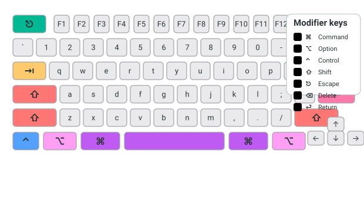

# mac-mastery

> macOS keyboard shortcuts and Mac tips, organized by **situation**, tagged by **level**, and packed with **memory hooks** so they actually stick.

## Why this repo is different

Most shortcut lists are just... lists. They're organized by app, dumped in a table, and forgotten. This repo is different:

1. **Situation-based.** Shortcuts are grouped by what you're *doing* (window management, text editing, finding files), not by which app owns them.
2. **Levels.** Every shortcut is tagged **Beginner**, **Power User**, or **Wizard** so you can learn at your own pace.
3. **Memory hooks.** Every shortcut has a short, funny, or visual mnemonic. If you can picture it, you won't forget it.

## Modifier key legend

| Symbol | Key | Where it sits on the keyboard |
|--------|-----|-------------------------------|
| ⌘ | Command | Bottom row, next to the space bar (the ⌘ "cloverleaf" key) |
| ⌥ | Option | Bottom row, between Control and Command (labeled "alt" on some keyboards) |
| ⌃ | Control | Bottom row, far left |
| ⇧ | Shift | Bottom row, second key in from each outside edge |
| ⎋ | Escape | Top-left corner |
| ⌫ | Delete | Top-right area (acts as Backspace; fn + delete = forward delete) |
| ⏎ | Return | Right side of the main typing area |
| ⇥ | Tab | Left side, just above Caps Lock |

Press **⌘ + ⇧ + /** in most apps to open that app's shortcut menu — the "what can I do here?" key.

## Level Progress Tracker

Check off each shortcut as you master it. Print the tracker or check the boxes on GitHub.

### Beginner (- [ ])
- [ ] ⌘ C — Copy
- [ ] ⌘ V — Paste
- [ ] ⌘ Z — Undo
- [ ] ⌘ A — Select All
- [ ] ⌘ Space — Spotlight
- [ ] ⌘ Tab — App Switcher
- [ ] ⌘ W — Close Window
- [ ] ⌘ H — Hide App
- [ ] Space — Quick Look
- [ ] ⌘ N — New Finder Window

### Power User (- [ ])
- [ ] ⇧ ⌘ Z — Redo
- [ ] ⌘ ⌥ V — Paste and Match Style
- [ ] ⌘ ⇧ 4 — Screenshot Selection
- [ ] ⌃ ⬆ — Mission Control
- [ ] ⌥ ← / → — Jump Word
- [ ] ⌥ ⌫ — Delete Word
- [ ] ⌃ ⌘ Space — Emoji Picker
- [ ] ⌘ ⇧ G — Go to Folder
- [ ] ⌘ ⇧ . — Show Hidden Files
- [ ] ⌥ ⌘ Esc — Force Quit

### Wizard (- [ ])
- [ ] defaults write — Hidden macOS tweaks
- [ ] pbcopy / pbpaste — Clipboard piping
- [ ] caffeinate — Keep Mac Awake
- [ ] ⌘ R at startup — Recovery Mode
- [ ] ⌥ ⌘ 8 — Accessibility Zoom
- [ ] ⌥ Click menu bar — Hidden menu options
- [ ] Hot Corners — Screen automation
- [ ] Automator — Workflow robot
- [ ] Text Replacements — Auto-expanding text
- [ ] Shortcuts app — Mac automation

## Table of Contents

- [01-basics](./01-basics) — Copy, paste, undo, screenshots, Spotlight, app switching
- [02-window-management](./02-window-management) — Mission Control, Spaces, full screen, split view, hiding and minimizing
- [03-text-editing](./03-text-editing) — Cursor jumping, selecting, deleting words and lines, emoji, accents
- [04-finder-and-files](./04-finder-and-files) — Rename, Quick Look, Go to Folder, hidden files, duplicate, path bar
- [05-safari-and-browsers](./05-safari-and-browsers) — Tabs, reopen closed tab, address bar, dev tools, reader mode
- [06-terminal-tricks](./06-terminal-tricks) — Useful commands, open ., pbcopy/pbpaste, caffeinate, defaults write, say
- [07-hidden-features](./07-hidden-features) — Option-click menu bar, Force Quit, Startup modes, Recovery, Accessibility zoom, Text Replacements
- [08-trackpad-gestures](./08-trackpad-gestures) — Trackpad gestures
- [09-automation](./09-automation) — Shortcuts app, Automator, Hot Corners, Focus modes
- [10-setup-new-mac](./10-setup-new-mac) — First-day checklist, recommended settings, free useful apps

## Shortcut of the Day

Pick **one** shortcut per day and use it at least five times. Print the [one-page cheatsheet](./cheatsheet.md) and tape it to your monitor.

### 30-Day Learning Plan

| Day | Shortcut | Folder | Level |
|-----|----------|--------|-------|
| 1 | ⌘ C — Copy | 01-basics | Beginner |
| 2 | ⌘ V — Paste | 01-basics | Beginner |
| 3 | ⌘ Z — Undo | 01-basics | Beginner |
| 4 | ⌘ A — Select All | 01-basics | Beginner |
| 5 | ⌘ Space — Spotlight | 01-basics | Beginner |
| 6 | ⌘ Tab — App Switcher | 01-basics | Beginner |
| 7 | Space — Quick Look | 04-finder-and-files | Beginner |
| 8 | ⌘ ⇧ 4 — Screenshot Selection | 01-basics | Power User |
| 9 | ⌃ ⬆ — Mission Control | 02-window-management | Beginner |
| 10 | ⌘ ` — Switch Windows (same app) | 02-window-management | Beginner |
| 11 | ⌥ ← — Jump Word Left | 03-text-editing | Power User |
| 12 | ⌥ ⌫ — Delete Word | 03-text-editing | Power User |
| 13 | ⌃ ⌘ Space — Emoji Picker | 03-text-editing | Beginner |
| 14 | ⌘ ⇧ G — Go to Folder | 04-finder-and-files | Power User |
| 15 | ⌘ ⇧ . — Show Hidden Files | 04-finder-and-files | Power User |
| 16 | ⌘ L — Address Bar | 05-safari-and-browsers | Beginner |
| 17 | ⇧ ⌘ T — Reopen Closed Tab | 05-safari-and-browsers | Beginner |
| 18 | ⇧ ⌘ R — Reader Mode (Safari) | 05-safari-and-browsers | Power User |
| 19 | open . — Open Folder in Finder | 06-terminal-tricks | Beginner |
| 20 | pbcopy — Copy Output to Clipboard | 06-terminal-tricks | Power User |
| 21 | caffeinate — Keep Mac Awake | 06-terminal-tricks | Power User |
| 22 | ⌥ ⌘ Esc — Force Quit | 07-hidden-features | Beginner |
| 23 | ⌘ R at startup — Recovery Mode | 07-hidden-features | Wizard |
| 24 | ⌥ ⌘ 8 — Accessibility Zoom | 07-hidden-features | Power User |
| 25 | Three-finger swipe — Switch Apps | 08-trackpad-gestures | Power User |
| 26 | Four-finger swipe up — Mission Control | 08-trackpad-gestures | Beginner |
| 27 | Hot Corner — Start Screen Saver | 09-automation | Power User |
| 28 | Text Replacement — Auto-expand text | 09-automation | Beginner |
| 29 | ⌘ ⇧ . — Show Hidden Files (review) | 04-finder-and-files | Power User |
| 30 | Review your Level Progress Tracker | — | — |

## Contributing

We love new shortcuts, fixes, and funny memory hooks. See [CONTRIBUTING.md](./CONTRIBUTING.md) for the row format, tone guidelines, and PR checklist.

## Version note

Shortcuts here were tested on recent macOS versions (macOS Ventura, Sonoma, and Sequoia). Some shortcuts differ by macOS version, keyboard layout, language, or app. If something doesn't work on your Mac, check **System Settings > Keyboard > Keyboard Shortcuts** (or **Trackpad** for gestures).

---

Built with ⌘ and ☕ by the macOS curious.
